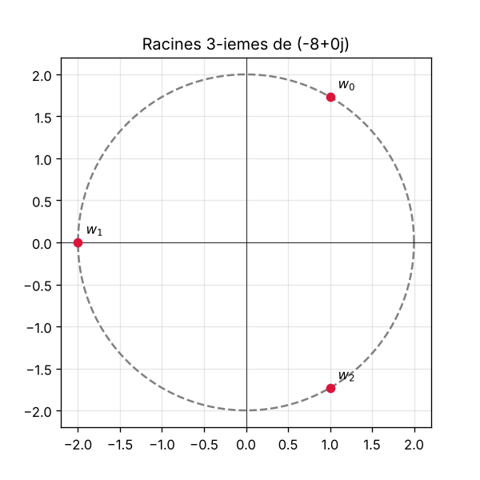

# Chapitre 01 : Complexes, racines n-ièmes

Script : [`scripts/01_complexes_racines.py`](../scripts/01_complexes_racines.py)

## Idée du cours
Les racines $n$-ièmes de $z = r e^{i\theta}$ sont les $n$ nombres
$$w_k = r^{1/n}\, e^{i(\theta + 2k\pi)/n}, \quad k = 0,\dots,n-1.$$
Elles sont sur le cercle de rayon $r^{1/n}$ et forment un polygone régulier.

## Ce que fait le script
1. Calcule le module et l'argument de `z`.
2. Applique la formule de Moivre pour obtenir les `n` racines.
3. Affiche chaque racine et vérifie que $w^n = z$.
4. Trace le cercle et les racines (fichier `01_complexes_racines.png`).

## À modifier
- `z` : le complexe dont on cherche les racines.
- `n` : l'ordre de la racine.

## Pour réfléchir
Que devient la figure quand $n$ augmente ? Pourquoi les racines sont-elles régulièrement espacées ?

