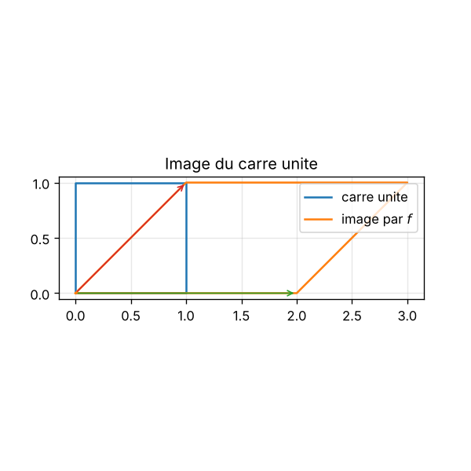

# Espaces vectoriels : applications linéaires

Script : [`scripts/03_applic_lineaire_plan.py`](../scripts/03_applic_lineaire_plan.py)

## Idée du cours
Une matrice $M$ représente une application linéaire $f$. On étudie son noyau, son image, son rang et ses valeurs propres.

## Ce que fait le script
1. Transforme le carré unité par $M$ et trace l'image (`03_applic_lineaire_plan.png`).
2. Dessine les images des vecteurs de base.
3. Affiche, avec `sympy`, le rang, le noyau, le déterminant et les valeurs propres.

## À modifier
`M` : testez une matrice de rang 1 (le carré s'écrase sur une droite), une rotation, une symétrie.

## Pour réfléchir
Que vaut l'aire de l'image du carré ? Quel lien avec le déterminant ?

